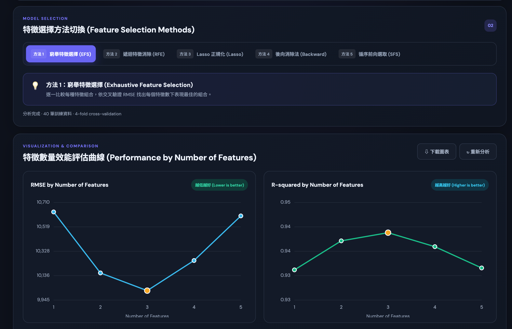

# Startup Feature Selection Lab

這個專案以 `50_Startups.csv` 練習新創公司利潤預測與特徵選擇，提供兩種使用方式：

1. **Python 分析程式**：執行特徵選擇、nested cross-validation、保留測試集評估，並輸出五張分析圖和一份方法比較表。
2. **互動式靜態網頁**：在瀏覽器載入 CSV、切換五種方法，查看不同特徵數的 RMSE、R² 和特徵組合。網頁不需要 Python 後端，可部署到 GitHub Pages。



## 專案檔案

| 檔案 | 用途 |
|---|---|
| `50_Startups.csv` | Python 程式使用的預設資料集。 |
| `50_startups_regression.py` | Python 分析、模型評估及圖表產生程式。 |
| `requirements.txt` | Python 分析所需套件。 |
| `index.html`、`styles.css`、`app.js` | 靜態互動網頁。 |
| `results/01_exhaustive_selection.png` | EFS 特徵數曲線與結果表。 |
| `results/02_rfecv.png` | RFE 特徵數曲線與結果表。 |
| `results/03_lasso.png` | Lasso 特徵數曲線與結果表。 |
| `results/04_backward_elimination.png` | Backward 特徵數曲線與結果表。 |
| `results/05_forward_selection.png` | SFS 特徵數曲線與結果表。 |
| `results/final_comparison.csv` | 五種方法的 nested CV、測試集分數及外層 fold 特徵紀錄。 |

## 分析資料與特徵

資料至少需要以下欄位：

- `R&D Spend`
- `Administration`
- `Marketing Spend`
- `State`
- `Profit`（預測目標）

三個支出欄位作為數值特徵；`State` 以 one-hot encoding 轉換。Python 使用 `pandas.get_dummies(..., drop_first=True)`，以 California 為基準類別，產生 `State_Florida` 和 `State_New York`。因此預設資料共有 5 個模型特徵。模型使用線性迴歸預測 Profit，並以 RMSE 和 R² 衡量表現。

## 五種特徵選擇方法

| 方法 | 程式中的做法 |
|---|---|
| **EFS — Exhaustive Feature Selection** | 對每個特徵數列舉所有特徵組合，以 CV RMSE 選出該數量下分數最低的組合。 |
| **RFE — Recursive Feature Elimination** | 反覆擬合線性迴歸，依係數移除較弱特徵；不同特徵數的表現以 fold 內重新執行 RFE 的方式評估。 |
| **Lasso** | 先標準化特徵，在 160 個由 `10⁻⁴` 到 `10⁶` 的 alpha 值中搜尋；非零係數對應被選取的特徵。 |
| **Backward — Backward Elimination** | 從完整特徵開始，逐步移除 OLS 中 p-value 最大的特徵，再比較各步驟留下的組合。 |
| **SFS — Sequential Forward Selection** | 從一個特徵開始，以交叉驗證逐步加入能改善分數的特徵。 |

## Python 評估流程

程式採用固定隨機種子，方便重現結果：

1. 以 `random_state=42` 將 50 筆資料切成 80% 訓練集（40 筆）和 20% 測試集（10 筆）。
2. 訓練集用 5-fold outer CV（`random_state=42`）估計整個特徵選擇流程的表現。每個 outer fold 只用該 fold 的訓練資料選特徵，然後在該 fold 的驗證資料產生預測。
3. 多數內層特徵或參數選擇使用 4-fold CV（`random_state=43`）。RFE 會在各 inner fold 內重新擬合 selector；Lasso 的 scaler 也在各 fold 內擬合。
4. 完成 nested CV 後，程式在完整 40 筆訓練資料上選定每種方法的特徵，再用該特徵組合重訓線性迴歸，最後評估同一組保留測試資料。

`results/final_comparison.csv` 中的 **Nested CV RMSE/R²** 是訓練資料上外層 folds 的整體預測成績，適合用來比較方法。**Test RMSE/R²** 是保留測試集的最後評估；不要根據測試集分數挑方法，否則測試集就不再是獨立評估資料。測試集只有 10 筆，分數也可能受個別資料列影響。

## 如何解讀五張 PNG 圖

五張圖中的曲線和表格呈現的是：切分後 40 筆訓練資料上的 **4-fold CV feature-count 探索結果**，不是 nested CV 的泛化效能估計。程式會依不同方法找出每個特徵數的候選組合並畫出 RMSE、R² 和特徵名；圖的標題已標明這是訓練集上的 4-fold CV。

部分方法會用同一組 CV 資料選特徵或 alpha，並呈現這組 CV 分數，因此結果可能偏樂觀：

- EFS 依該 CV 分數挑出最佳子集合，再呈現其分數。
- Backward 的移除路徑由完整訓練集擬合，再評估路徑上的特徵組合。
- SFS 和 Lasso 也會在訓練集上用 CV 選擇特徵或 alpha，圖中分數不是獨立的外層估計。
- RFE 的 CV 預測會在各 fold 內重新做 RFE；表格中的特徵名則是用完整訓練集擬合出的 RFE 組合，可能和各 fold 實際選到的組合不同。

因此，這些圖適合觀察方法路徑與特徵數變化，不應取代 `final_comparison.csv` 的 nested CV 結果。若要比較「固定特徵數下整個選擇程序」的無偏表現，應對每個特徵數分別做 nested CV。

## 建立環境與執行 Python 分析

在專案根目錄執行以下指令：

```bash
python3 -m venv .venv
source .venv/bin/activate
python -m pip install -r requirements.txt
python 50_startups_regression.py
```

Windows PowerShell 的環境啟用指令為：

```powershell
py -m venv .venv
.venv\Scripts\Activate.ps1
python -m pip install -r requirements.txt
python 50_startups_regression.py
```

程式會從專案根目錄讀取 `50_Startups.csv`，並在 `results/` 建立或更新五張 PNG 和 `final_comparison.csv`。執行前請確認目前工作目錄是專案根目錄。

## 本機預覽互動網頁

網頁以瀏覽器端 JavaScript 計算，不需要啟動 Python API。從專案根目錄啟動簡單 HTTP server：

```bash
python3 -m http.server 8765
```

接著瀏覽 [http://localhost:8765/](http://localhost:8765/)。結束 server 時，在啟動它的終端機按 `Ctrl+C`。請透過 HTTP server 開啟頁面，不要直接以 `file://` 開啟，因為瀏覽器可能限制本機檔案存取。

網頁預設使用這個公開 CSV：

<https://raw.githubusercontent.com/Avik-Jain/100-Days-Of-ML-Code/refs/heads/master/datasets/50_Startups.csv>

展開 **DATA SOURCE 資料來源設定** 可輸入其他 CSV 網址。該網址必須可公開讀取、回傳 CSV 內容，且來源伺服器需允許 CORS。網頁要求 CSV 含上述五個欄位；載入後會依 `State` 類別建立 dummy 特徵。

網頁目前比照 Python 圖表，以 `random_state=42` 做 80/20 切分，再對 40 筆訓練資料做 `random_state=43` 的 4-fold CV。網頁曲線同樣是探索用分數，不是 nested CV 泛化估計；瀏覽器版 Lasso 使用 JavaScript 座標下降求解，與 scikit-learn 的分數可能有極小數值差異。

